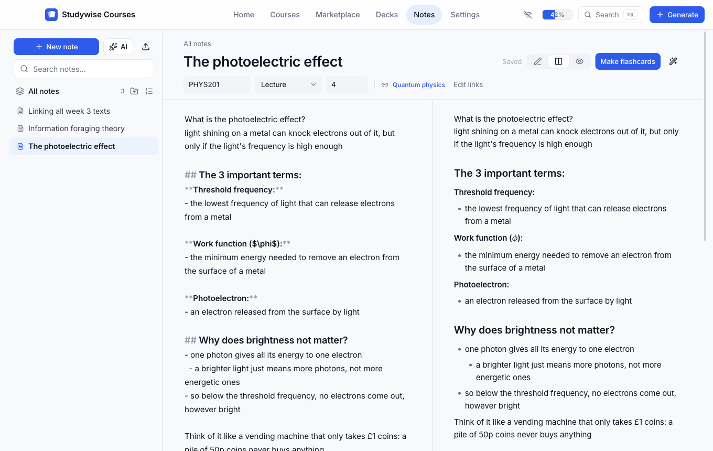

# Studywise Courses

A course, flashcard and notes app for Mac and Windows, with an Android app that syncs with it.

Make a course for a module, then add each week's slides, transcripts and readings. Claude splits every week into topics and teaches each one in short sections: a screen of notes (with the slide's figure if it helps), a few quick questions, then the next bit. Each topic has a separate test you take from the course page when you're ready, and leaves recall cards that pop up while you learn other topics and in spaced review.

It also keeps everything from Studywise: give it a lecture PDF and it makes notes and flashcards, then quizzes you and marks your answers.

Weeks you've made can be published to a course marketplace ([studywise-server](https://github.com/SnakeLuck360GT/studywise-server), self-hostable with Docker), where other people browse them and add them without generating anything. Before you plan a week, Studywise checks whether someone has already published one made from the same slides.

It uses Claude Code on your computer (you need a Claude account), or Ollama: its cloud models with an API key, or models on your own Ollama server. You can import Anki decks (`.apkg`) and study them like any other deck.


| | |
|---|---|
|  |  |
|  |  |

## Setup

Install Claude Code and log in:

```sh
npm install -g @anthropic-ai/claude-code
claude
```

Or use Ollama instead: open Settings → AI provider, pick Ollama, paste an API key from [ollama.com/settings/keys](https://ollama.com/settings/keys), then choose your models in Settings → Models.

Then build the app:

```sh
npm install
npm run dist       # Mac: release/Studywise-Courses.dmg
npm run dist:win   # Windows: release/Studywise-Courses-Setup.exe
```

The app isn't signed. On a Mac, right-click it and pick Open the first time. On Windows, click More info, then Run anyway.

## Android app

The phone app is the same app laid out for a phone: courses, decks, flashcards and notes, stored on the phone so you can study offline. It syncs both ways with Studywise on your computer over your Wi‑Fi, and AI features on the phone (Explain, marking written answers, writing topics, generating cards) run on the computer.

Build it (needs Android Studio, or the Android SDK and a JDK 17–21):

```sh
npm run android:apk    # release/Studywise-android.apk
```

Install the APK on your phone (allow installing from unknown sources), then pair it: on the computer open Settings → Devices, turn on syncing and press Pair a device; on the phone open Settings → Sync and type the address and code it shows. Both need to be on the same network (or the same Tailscale network).

To move your library to another computer (and keep the two in sync), do the same on the computer that has it, then on the new one open Settings → Devices → Link to another computer and type the address and code. No file to copy.

To study without AI (no internet, no Claude login), turn on **Offline** at the top of the window: Learn and course topics then only ask questions that are marked without AI.

`npm run android:run` builds and runs it on a connected phone or emulator. To work on the phone layout in a browser, run `npm run sync:demo` (a desktop backend with a demo library and mock AI that prints a pairing code) and `npm run mobile:dev`, then open http://localhost:5199 at phone size.

## Development

```sh
npm run dev        # run the app
npm test           # unit tests
npm run test:e2e   # end-to-end test
```

Set `AI_MOCK=1` to use fake AI replies instead of Claude.

More detail is in [docs/how-it-works.md](docs/how-it-works.md).

Not affiliated with Anthropic or StudySmarter.
