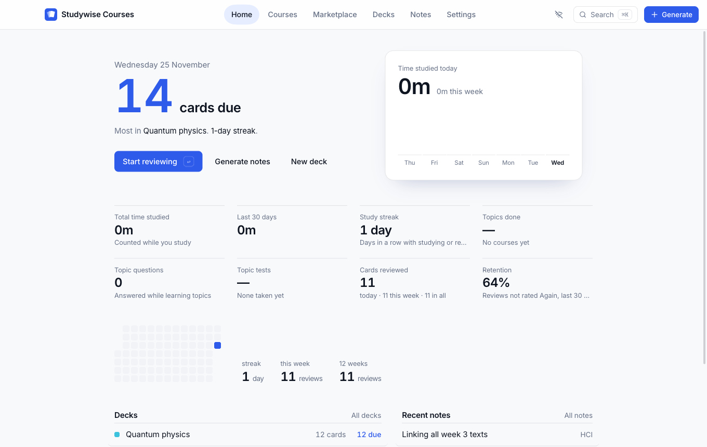
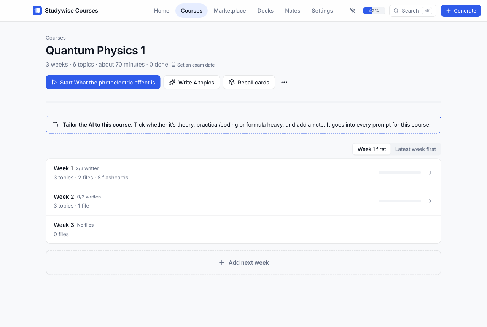
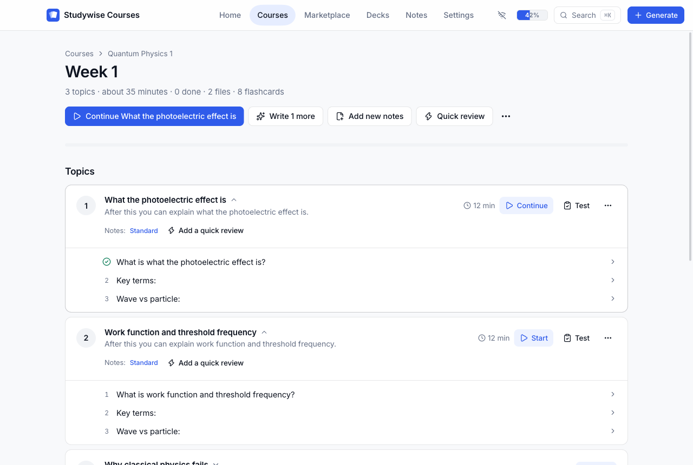
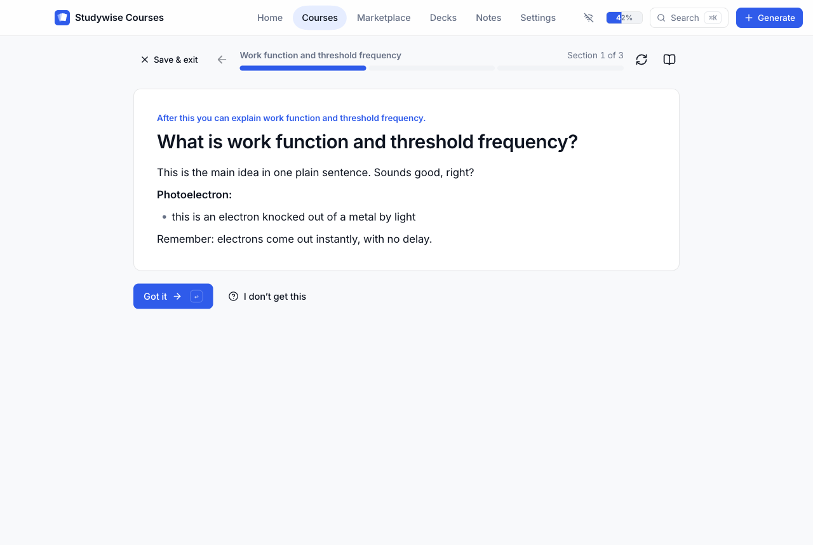
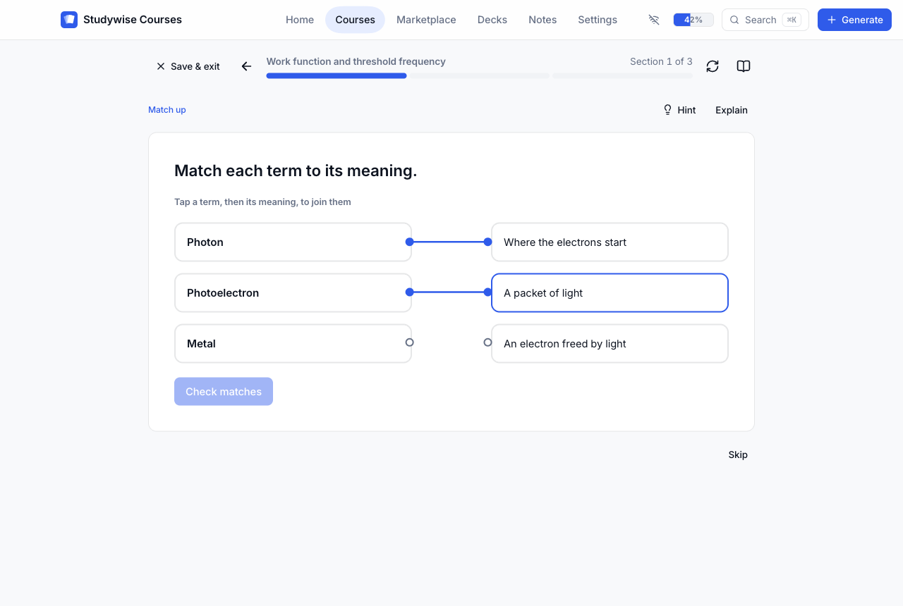
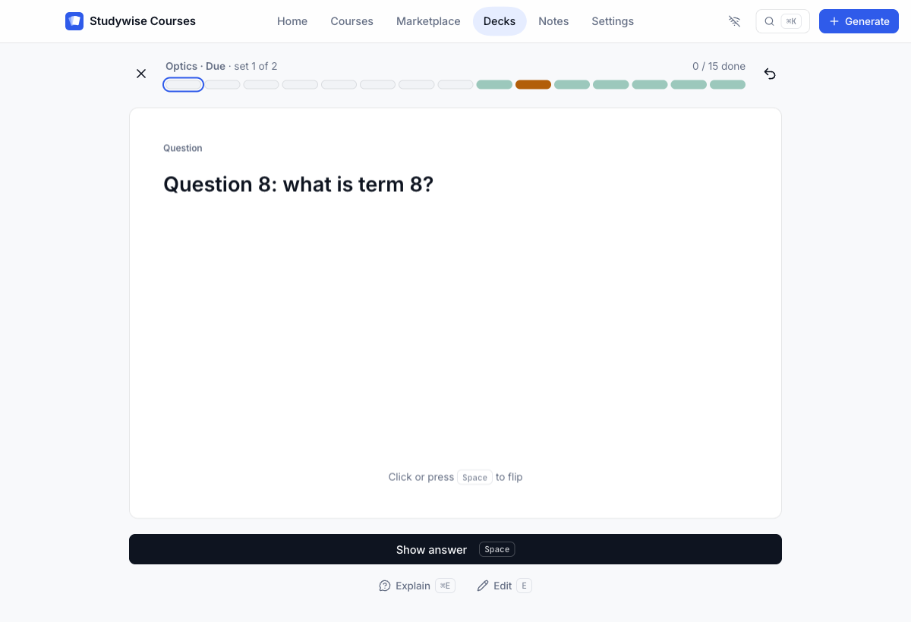
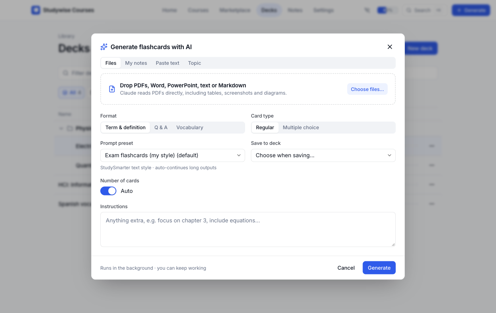
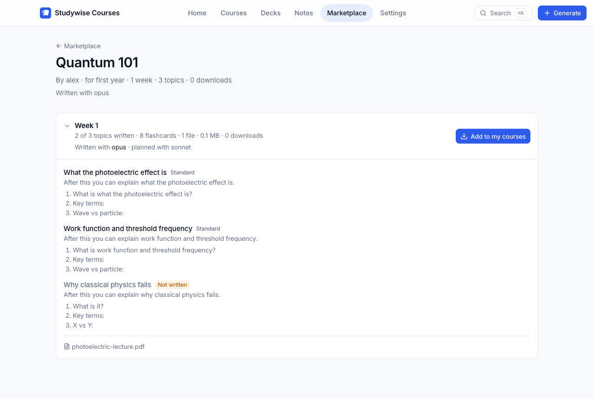

# Studywise Courses

A study app for Mac and Windows (with an Android app that syncs to it). Give it your lecture slides and it turns each week into short lessons, practice questions and flashcards.



## Download

Get the latest version from [Releases](https://github.com/SnakeLuck360GT/studywise-courses/releases/latest):

- **Mac:** `Studywise-Courses.dmg`. Open it and drag Studywise Courses to Applications.
- **Windows:** `Studywise-Courses-Setup.exe`.

The app isn't signed. On a Mac, right-click it and pick **Open** the first time. On Windows, click **More info**, then **Run anyway**. It tells you when there’s a new version.

## Set up the AI

Studywise uses **Claude Code** on your computer, so you need a Claude account:

```sh
npm install -g @anthropic-ai/claude-code
claude   # log in once
```

Or use **Ollama**: in Settings → AI provider pick Ollama, paste an API key from [ollama.com/settings/keys](https://ollama.com/settings/keys), then choose models in Settings → Models.

No AI to hand? Turn on **Offline** in the top bar and you can still study everything you've already made.

## Courses

Make a course for a module and add each week's slides, transcripts and readings. Studywise splits the week into topics.

| | |
|---|---|
|  |  |

## Learning a topic

Each topic is taught in short sections: a screen of notes, then a few quick questions (multiple choice, fill the gap, put in order, match up, explain in your own words…), then the next bit. When you're ready, take the topic's test from the week page.

| | |
|---|---|
|  |  |

## Flashcards

Every course makes flashcards, and you can make decks of your own too, from a PDF, from your notes, or from an Anki deck (`.apkg`).

You go through them in sets of 15 and mark each card **red**, **yellow** or **green** (keys **1**, **2**, **3**). Two greens and a card is learnt; after that it comes back after 1 day, then 3, then 7, and so on, further apart each time you remember it.





## Notes

Write your own notes in Markdown, sorted into folders. Turn any note into flashcards with one click.


## Marketplace

Publish the weeks you've made so other people on the same module can add them for free, without generating anything. Before you plan a week, Studywise checks whether someone has already made it from the same slides.

The marketplace runs on [studywise-server](https://github.com/SnakeLuck360GT/studywise-server), which you can host yourself with Docker.



## Android app

The phone app has your courses, decks, flashcards and notes, and works offline. It syncs with the computer over Wi‑Fi, and anything that needs AI runs on the computer.

1. Build it with `npm run android:apk` (needs Android Studio, or the Android SDK and JDK 21) and install `release/Studywise-android.apk`.
2. On the computer: Settings → Devices → turn on syncing → **Pair a device**.
3. On the phone: Settings → Sync, and type the address and code the computer shows.

The same pairing (Settings → Devices → **Link to another computer**) moves your library to a second computer and keeps the two in sync.

## Build it yourself

```sh
npm install
npm run dev        # run it
npm test           # tests (fake AI, no account needed)
npm run dist       # Mac: release/Studywise-Courses.dmg
npm run dist:win   # Windows: release/Studywise-Courses-Setup.exe
```

Set `AI_MOCK=1` to run the app with fake AI replies. How everything works is in [docs/how-it-works.md](docs/how-it-works.md).

## Want to add something?

Ideas and fixes are welcome. Fork the repo, make your change on a branch, check `npm test` and `npm run typecheck` pass, and open a pull request saying what it does and why. For anything big, open an issue first so we can talk it through.

---

Not affiliated with Anthropic or StudySmarter.
